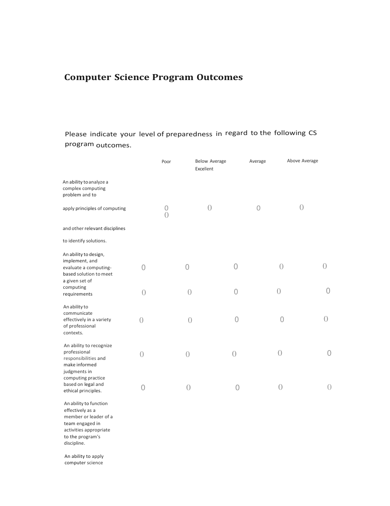

# Year 0 Assessment Plan Report {#report}

::: {.editorial-note role="note"}
**Reconstruction note (editorial):** This reading edition preserves the source wording, including apparent errors. Numbered review notes identify unresolved source issues. The survey is presented as document content, not a working form. Its outcome-rating layout requires review. No accessibility conformance claim is made.
:::

Academic Year 2023-2024 of Year 0 Plan  
College: NACOE  
Department: GSoC  
Submitted by: John Paxton / Daniel DeFrance

Year 0 Assessment Plan Report is due October 15th.

## Program(s) to be Assessed. {#programs}

List all majors, minors, certificates and/or options that are included in this new Assessment Plan

<table id="programs-table">
<caption data-editorial="true">Program(s) to be Assessed</caption>
<thead><tr><th scope="col">Majors/Minors/Certificate</th><th scope="col">Options</th></tr></thead>
<tbody><tr><th scope="row">Computer Science B.A.</th><td></td></tr></tbody>
</table>

::: {.editorial-note role="note"}
**Editorial note:** The Options cell is blank in the source. Two wholly blank template rows have been omitted.
:::

## Part 1: Program Learning Outcomes (PLOs). {#part-1}

List the Program Learning Outcomes (these should match what is in CIM)

<table id="plos-table">
<caption data-editorial="true">Program Learning Outcomes</caption>
<thead><tr><th scope="col">PLO#</th><th scope="col">PLO Description</th></tr></thead>
<tbody>
<tr><th scope="row">1</th><td>Analyze a complex computing problem and to apply principles of computing and other relevant disciplines to identify solutions.</td></tr>
<tr><th scope="row">2</th><td>Design, implement, and evaluate a computing-based solution to meet a given set of computing requirements in the context of the program’s discipline.</td></tr>
<tr><th scope="row">3</th><td>Communicate effectively in a variety of professional contexts.</td></tr>
<tr><th scope="row">4</th><td>Recognize professional responsibilities and make informed judgments in computing practice based on legal and ethical principles.</td></tr>
<tr><th scope="row">5</th><td>Function effectively as a member or leader of a team engaged in activities appropriate to the program’s discipline.</td></tr>
<tr><th scope="row">6</th><td>Apply computer science theory and software development fundamentals to produce computing-based solutions.</td></tr>
</tbody>
</table>

## Part 2: Development of Assessment Plan. {#part-2}

Each plan will require the following information:

### a) Threshold Values. {#thresholds}

<table id="thresholds-table">
<caption>Threshold Values</caption>
<thead><tr><th scope="col">PROGRAM LEARNING OUTCOME</th><th scope="col">Threshold Value</th><th scope="col">Data Source</th></tr></thead>
<tbody><tr><th scope="row">Outcomes 1, 2, 3, 4, 5, 6</th><td>50% or more of the assessed students must receive a 3 or 4 on a 1-4 scoring rubric.</td><td>Randomly selected portfolios and capstone exams</td></tr></tbody>
</table>

### b) Methods of Assessment & Data Source. {#methods}

Indirect Methods:

- Graduating Senior Survey (see [Appendix C](#appendix-c) for survey)
- Possibly end of semester course evaluations for ESOF 423

Direct Methods:

- Capstone Portfolio Evaluation (see [Appendix B](#appendix-b) for categories with grading rubric)
- Custom Exam Evaluation (see [Appendix A](#appendix-a) for questions with grading rubric)

### c) Timeframe for Collecting and Analyzing Data. {#timeframe}

Data will be collected every year and assessed every second year according to the table below.

### d) Curriculum Map & Assessment Planning Chart. {#curriculum-map}

<table id="planning-table">
<caption>ASSESSMENT PLANNING CHART</caption>
<thead><tr><th scope="col">Program Learning Outcomes</th><th scope="col">Course Alignments: Include rubric, number, and course title</th><th scope="col">Identification of Assessment Artifact</th><th scope="col">Year to be assessed</th></tr></thead>
<tbody>
<tr><th scope="row">#1. Analyze a complex computing problem and apply principles of computing and other relevant disciplines to identify solutions.</th><td><ul><li>CSCI 232, Data Structures and Algorithms</li><li>ESOF 423, Software Engineering Applications</li><li>non-STEM concentration</li></ul></td><td>Capstone portfolio indicators 3, 5, 6</td><td><ul><li>2024-2025</li><li>2026-2027</li><li>2028-2029</li></ul></td></tr>
<tr><th scope="row">#2. Design, implement, and evaluate a computing-based solution to meet a given set of computing requirements in the context of the program’s discipline.</th><td><ul><li>CSCI 232, Data Structures and Algorithms</li><li>ESOF 423, Software Engineering Applications</li></ul></td><td>Custom exam questions 1, 2, 3</td><td><ul><li>2024-2025</li><li>2026-2027</li><li>2028-2029</li></ul></td></tr>
<tr><th scope="row">#3. Communicate effectively in a variety of professional contexts.</th><td><ul><li>US and W core courses</li><li>ESOF 423, Software Engineering Applications</li><li>The non-STEM concentration</li></ul></td><td>Capstone portfolio indicator 4, custom exam question 4</td><td><ul><li>2024-2025</li><li>2026-2027</li><li>2028-2029</li></ul></td></tr>
<tr><th scope="row">#4. Recognize professional responsibilities and make informed judgments in computing practice based on legal and ethical principles.</th><td><ul><li>ESOF 423, Software Engineering Applications</li></ul></td><td>Custom exam questions 5, 6, 7</td><td><ul><li>2024-2025</li><li>2026-2027</li><li>2028-2029</li></ul></td></tr>
<tr><th scope="row">#5. Function effectively as a member or leader of a team engaged in activities appropriate to the program’s discipline.</th><td><ul><li>ESOF 423, Software Engineering Applications</li></ul></td><td>Capstone portfolio indicators 2, 7</td><td><ul><li>2024-2025</li><li>2026-2027</li><li>2028-2029</li></ul></td></tr>
<tr><th scope="row">#6. Apply computer science theory and software development fundamentals to produce computing-based solutions.</th><td><ul><li>CSCI 232, Data Structures and Algorithms</li><li>CSCI 246, Discrete Mathematics</li><li>ESOF 322, Software Engineering</li></ul></td><td>Capstone portfolio indicator 1</td><td><ul><li>2024-2025</li><li>2026-2027</li><li>2028-2029</li></ul></td></tr>
</tbody>
</table>

::: {.editorial-note role="note"}
**Editorial note:** The three year cells in each source row have been combined into one list under their shared header. All 18 year entries are retained.
:::

## Part 3: What Will be Done. {#part-3}

### a) How will assessment artifacts be identified? {#artifact-identification}

The assessment artifacts are based on the ones that we created for the rigorous ABET assessment process that we use to accredit our Computer B.S. degree (both the professional and interdisciplinary options).

### b) How will they be collected (and by whom)? {#artifact-collection}

The custom exam and graduating senior survey are collected when students take CSCI 481, Program Assessment, during their final semester. The CSCI 481 instructor is responsible for collecting these artifacts. The capstone portfolios are produced when students take ESOF 483, Software Engineering Applications. ESOF 423 is the capstone course for the Computer Science B.A. The ESOF 423 instructor is responsible for collecting these artifacts.

::: {.editorial-note role="note" #review-1}
**Review 1 - course number:** The source says “ESOF 483” and then “ESOF 423” in this paragraph. Both are retained. Confirm the intended course number; “Computer B.S.” in the preceding paragraph is also retained as printed.
:::

### c) Who will be assessing the artifacts? {#artifact-assessment}

Professors Hunter Lloyd and Binhai Zhu are responsible for assessing the capstone portfolios. Professors Brendan Mumey and John Paxton are responsible for assessing the custom exams. The graduating senior surveys are shared with all GSoC faculty for discussion at our annual retreat.

## Part 4: Assessment-Specific Rubrics. {#part-4}

See Appendix for custom exam and grading rubric. It is also available at <https://www.cs.montana.edu/paxton/abet/custom-exams/>

See Appendix for custom exam and grading rubric. It is also available at <https://www.cs.montana.edu/paxton/abet/portfolios/>

::: {.editorial-note role="note" #review-2}
**Review 2 - repeated description:** Both source paragraphs say “custom exam,” including the paragraph linking to portfolios. Wording is retained; confirm the second description.
:::

## Part 5: Program Assessment Report Communication {#part-5}

### a) How will annual assessment be communicated to faculty within the department? How will faculty participating in the collecting of assessment data (student work/artifacts) be notified? {#communication}

The assessment results are communicated to the GSoC faculty in advance of our annual August retreat so that changes to address weaknesses can be discussed. The faculty who collect the assessment data are the instructors of ESOF 423 and CSCI 481.

### b) When will the data be collected and reviewed, and by whom? {#collection-review}

The ESOF 423 capstone portfolios are collected at the end of each Spring Semester. The custom exam is given as part of CSCI 481 each Fall and Spring Semester. The graduating senior survey is given as part of CSCI 481 each Fall and Spring Semester.

The capstone portfolios are assessed by Hunter Lloyd and Binhai Zhu following Spring Semester. The custom exams are assessed by Brendan Mumey and John Paxton following Spring Semester. The graduating senior surveys are given to all GSoC faculty to review in advance of our annual retreat in August.

### c) Who will be responsible for the writing of the report? {#report-writing}

Dan DeFrance and John Paxton are responsible for writing the report.

### d) How, when, and by whom, will the report be shared? {#report-sharing}

The report will be shared with the GSoC faculty by Dan DeFrance and John Paxton for discussion at a faculty meeting after our annual retreat in August.

### e) Closing the Loop(s). How will Closing the Loop be documented going forward? How will past assessments be used to inform changes and improvements? {#closing-loops}

At our annual August retreat, we will discuss the assessment data and findings to discuss potential changes to courses and/or curriculum. The changes that are made will be documented in future assessment reports and these reports will be shared with GSoC faculty. Extra attention will be given to these changes in future assessment cycles to evaluate whether they are having the desired impact.

Submit report to <programassessment@montana.edu>

## Appendix A - Custom Exam with Evaluation Rubric {#appendix-a}

### Section I. Grading Rubrics {#exam-rubrics}

#### Question 1 {#exam-q1}

**Student Outcome 2A - Design a computing-based solution to meet a given set of computing requirements in the context of the program’s discipline**

A company uses a ticket system for customer service. Each ticket is given an urgency score when it is entered into the system. For example, a VIP customer would receive a higher urgency score than a regular customer. Assume that the urgency scores range from 1 to 10,000. The company’s customer service team needs a way to find the most urgent ticket in the system and remove it when it has been addressed. New tickets can arrive at any time.

a) What simple data structure would best model this situation? Explain.
b) Describe one way in which this data structure could be implemented and draw a picture of that data structure.
c) Describe a second way in which this data structure could be implemented and draw a picture of that data structure.

Evaluation

1. Incorrect data structure.
2. Correct data structure, no implementations.
3. Correct data structure, one correct implementation.
4. Correct data structure, two correct implementations.

#### Question 2 {#exam-q2}

**Student Outcome 2B - Implement a computing-based solution to meet a given set of computing requirements in the context of the program’s discipline**

Write a function in a language of your choice that has two parameters: a string and a character. The function should return the number of times that the character occurs in the string.

1. 3 or more logic errors in solution.
2. 2 logic errors in solution.
3. 1 logic error in solution.
4. No logic errors in solution.

#### Question 3 {#exam-q3}

**Student Outcome 2C - Evaluate a computing-based solution to meet a given set of computing requirements in the context of the program’s discipline**

Consider a singly linked list that contains n floating point numbers and is maintained in ascending order. An additional k floating point numbers will be added to the list, one at a time. You may assume that k &lt;&lt; n.

a) What is the best case time complexity of this algorithm? Explain.
b) What is the worst case time complexity of this algorithm? Explain.

Evaluation:

1. Neither case has the correct time complexity.
2. One case has the correct time complexity but the wrong explanation.
3. One case is fully correct.
4. Both cases are fully correct.

#### Question 4 {#exam-q4}

**Student Outcome 3B - Communicate via speaking effectively**

List any extracurricular community involvement (e.g. the Gallatin Valley Food Bank or coaching), extracurricular university involvement (e.g. Engineering Ambassadors, Swing Cats, ACM or AWC), or paid internships (e.g. Workiva intern or Undergraduate Course Assistant) that you were involved with during your time at MSU. For each activity, (1) **provide** the name of the organization, (2) **describe** briefly your main activities and (3) **estimate** the total number of hours you spent.

1. No involvement
2. Less than 25 hours
3. Less than 50 hours
4. 50 hours or more

#### Question 5 {#exam-q5}

**Student Outcome 4A - Recognize professional responsibilities**

IEEE P7003 defines the Algorithmic Bias Standard.

a) Describe briefly what algorithmic bias is.
b) Provide a hypothetical example of how algorithmic bias could manifest itself in college admissions software.

1. Incorrect response.
2. Accurate description of algorithmic bias.
3. Accurate description of algorithmic bias plus partially correct example.
4. Accurate description of algorithmic bias plus correct example.

#### Question 6 {#exam-q6}

**Student Outcome 4B - Make informed judgments in computing practice based on legal principles**

In 2010 Oracle sued Google claiming copyright and patent infringement for 11,500 lines of Java API copied code. Google used this small subset of code from the JAVA API for their mobile platform operating system. Pick a side (Google or Oracle) to win this lawsuit and explain 3 possible impacts to the computing industry of this win.

1. No answer.
2. One impact explained.
3. Two impacts explained.
4. Three impacts explained.

#### Question 7 {#exam-q7}

**Student Outcome 4C - Make informed judgments in computing practice based on ethical principles**

In the ACM Code of Ethics and Professional Conduct, one ethical principle stated is to ***avoid harm***. Describe three different types of harm that the software of an autonomous, self-driving car might cause.

1. No answer.
2. One correct type of harm.
3. Two correct types of harm.
4. Three correct types of harm.

#### Question 8 {#exam-q8}

**Program Educational Objective 1 - Be well prepared for a professional career in computing or graduate studies in computer science**

Describe your one-year plan following graduation. If you plan to work, list where you have applied (the company and the position) and mention whether you have received any offers. If you plan to go to graduate school, list where you have applied (the school and the area of study) and mention whether you have received any acceptances.

1. No career or educational plans mentioned.
2. The student plans to pursue a job that is not CS-related.
3. The student has applied for a CS-related job or to graduate school.
4. The student has a CS-related job offer or graduate school admission.

#### Question 9 {#exam-q9}

**Program Educational Objective 3 - Has appropriate social and professional skills to work effectively within a diverse organization - social skills**

List any organized social activities that you were involved with during your time at MSU. For each activity, (1) **provide** the name of the organization, (2) **estimate** the total number of hours you spent.

1. No involvement
2. Less than 25 hours
3. Less than 50 hours
4. 50 hours or more

#### Question 10 {#exam-q10}

**Program Educational Objective 3 - professional skills**

List any activities that you were involved with during your time at MSU that prepared you to work more effectively with teammates whose backgrounds are significantly different than your own. For each activity, (1) **describe** the activity and (2) **estimate** the total number of hours you spent.

1. No involvement
2. Less than 25 hours
3. Less than 50 hours
4. 50 hours or more

#### Question 11 {#exam-q11}

**Program Educational Objective 3 - professional skills**

Name the most sophisticated version control system that you use and describe three nontrivial features it has.

1. No version control system stated
2. A version control system stated and one feature described
3. A version control system stated and two features described
4. A version control system stated and three features described

#### Question 12 {#exam-q12}

**Program Educational Objective 5 - Engages in continuous learning**

During your time at MSU, list any major non-classroom, non-paid activities that you engaged in to help prepare for your computer science career. For example, you might have taught yourself a programming language or attended a workshop on a CS topic. For each activity, estimate the number of hours spent.

1. Less than 10 hours
2. Less than 50 hours
3. Less than 100 hours
4. 100 hours or more

### Section II. Desired Performance Level {#exam-performance}

The assessment committee decided that the desired performance level on each question would be achieved 50% or more of the students taking the exam scored a 3 or better.

::: {.editorial-note role="note" #review-3}
**Review 3 - source wording and thresholds:** The sentence above appears to be missing a connecting word after “achieved”; none has been supplied. This appendix and Part 2 use “50% or more,” while Appendix B uses “more than 50%.” Confirm whether the difference is intentional. The hour-based scoring bands in Questions 4, 9, 10, and 12 overlap as written; their bounds are preserved.
:::

### Section III. Evaluation Methodology {#exam-methodology}

Two computer science faculty members independently graded the exams. Each grader then identified the questions where the desired performance level was not achieved. If there is not agreement, a third member of the assessment committee grades in order to break the tie.

## Appendix B - Portfolio Criteria with Evaluation Rubric {#appendix-b}

### Section I. Grading Rubrics {#portfolio-rubrics}

#### Indicator 1: Program. {#portfolio-i1}

Attach a source listing of the program that you wrote for your capstone course (CSCI 468, CSCI 483 or ESOF 423). Include the specifications for the program.

Evaluation:

1. No program in portfolio.
2. Program submitted with no, or incomplete, specifications.
3. Program did not meet specifications
4. Specifications and a matching program both submitted.

#### Indicator 2: Teamwork. {#portfolio-i2}

Describe how your team worked on this capstone project. List each team member’s primary contributions and estimate the percentage of time that was spent by each team member on the project. Identify team members generically as team member 1, team member 2, etc.

Evaluation:

1. No team project information in portfolio.
2. One or more team members did not affect the success of the project.
3. Some team members only completed a specific component of the project, without regard to the rest of the project.
4. Demonstrated genuine teamwork, where the team worked together to develop the project.

#### Indicator 3: Design pattern. {#portfolio-i3}

Identify one design pattern that was used in your capstone project and describe exactly where in the code it is located. Highlight the design pattern in yellow. Explain why you used the pattern and didn’t just code directly.

Evaluation:

1. No design pattern information in portfolio.
2. A design pattern was used, but wasn’t justified as the best approach.
3. A design pattern was used, but with incomplete justification.
4. A fully justified design pattern was used.

#### Indicator 4: Technical writing. {#portfolio-i4}

Include the technical document that accompanied your capstone project.

Evaluation:

1. No technical documentation example in portfolio.
2. Documentation contained ten or more grammatical and/or spelling errors per page, or was poorly formatted.
3. Documentation had less than ten grammatical or spelling errors per page, but did not accurately describe the project.
4. Documentation fully described the project.

#### Indicator 5: UML. {#portfolio-i5}

Show UML diagrams for your capstone project. What parts of the UML diagrams did you create?

1. No UML information in portfolio.
2. Diagrams and code don’t match.
3. Diagrams and code match, at most two types of UML diagrams used in the project.
4. Diagrams and code match, more than two types of UML diagrams used in the project.

#### Indicator 6: Design trade-offs. {#portfolio-i6}

Describe a design trade-off decision (e.g. execution time vs. space requirements or compile time) in your capstone project and justify the design decisions that you made.

Evaluation:

1. No design trade-off information in portfolio, or the example given is not explained as a design trade-off.
2. A design trade-off is described, but no justification is given.
3. A design trade-off is described, but the decision made was not justified correctly.
4. A design trade-off is described, with correct analysis.

#### Indicator 7: Software development life cycle model. {#portfolio-i7}

Describe the model that you used to develop your capstone project. How did this model help and/or hinder your team?

Evaluation:

1. No life cycle information in portfolio.
2. Development did not follow the life cycle described.
3. Development followed the life cycle model described.
4. Development followed the life cycle model described, and benefits and/or problems were described.

### Section II. Desired Performance Level {#portfolio-performance}

The assessment committee decided that the desired performance level on each indicator would be achieved if more than 50% of the students taking the exam achieved a 3 or better.

::: {.editorial-note role="note" #review-4}
**Review 4 - portfolio criterion:** “More than 50%” and “students taking the exam” are retained from this portfolio appendix. Confirm the threshold and whether “exam” is intended. See also Review 3.
:::

### Section III. Evaluation Methodology {#portfolio-methodology}

Two of the assessment committee members independently graded the portfolios. Each grader then identified the indicators where the desired performance level was not achieved. If there had been serious disagreement about the scores, a third member of the assessment committee would have graded in order to break the tie.

## Appendix C - Portfolio Criteria with Evaluation Rubric {#appendix-c}

::: {.editorial-note role="note" #review-5}
**Review 5 - appendix title:** This is the printed title, although the content is a survey and Part 2 calls Appendix C the Graduating Senior Survey. Confirm the intended title. Blank answer areas are omitted; no responses are supplied.
:::

Please give us your feedback regarding your computer science experience.

- Which 2-3 courses were the most valuable? Explain.
- Which 2-3 courses were the least valuable? Explain.
- Are there any courses missing from the curriculum?
- Did you participate in an internship?
    - Yes
    - No

### Advising, Facilities, and Website {#survey-advising}

- Please comment on your advising experience with the Academic Advisor who advised you through CSCI 132. How could this experience be improved?
- Please comment on your advising experience with the Faculty Advisor who advised you after CSCI 132. How could this experience be improved?
- Are computing labs on campus adequate to support your computing courses? What improvements would you suggest?
- Are you satisfied with the department web site? What suggestions do you have for improving it?
- How do you prefer to receive communications from the School of Computing?

### Computer Science Program Outcomes {#survey-outcomes}

Please indicate your level of preparedness in regard to the following CS program outcomes.

::: {.editorial-note role="note" #review-6}
**Review 6 - uncertain survey structure:** Source page 14 has displaced rating labels and circles. The labels are transcribed below in a proposed low-to-high order; the six outcome statements follow in source text order. The intended association of one five-choice scale with each outcome is plausible but is **not verified**. No choices or student responses are inferred. Confirm the scale order and row associations before creating a usable questionnaire. The second statement ends at “requirements” in the source; wording from Part 1 has not been added.
:::

<strong>Rating labels (editorial grouping; subject-matter review required):</strong>

- Poor
- Below Average
- Average
- Above Average
- Excellent

<strong>Outcome statements (editorial list structure):</strong>

1. An ability to analyze a complex computing problem and to apply principles of computing and other relevant disciplines to identify solutions.
2. An ability to design, implement, and evaluate a computing-based solution to meet a given set of computing requirements
3. An ability to communicate effectively in a variety of professional contexts.
4. An ability to recognize professional responsibilities and make informed judgments in computing practice based on legal and ethical principles.
5. An ability to function effectively as a member or leader of a team engaged in activities appropriate to the program's discipline.
6. An ability to apply computer science theory and software development fundamentals to produce computing-based solutions.

Source layout evidence for Review 6

<figure>

<figcaption id="survey-evidence-caption">Verification image, not a replacement for the transcribed text above. Draft description requires subject-matter review; the intended circle-to-outcome relationships remain uncertain.</figcaption>
</figure>

### Additional Questions {#survey-additional}

Is there anything else you would like to share?
